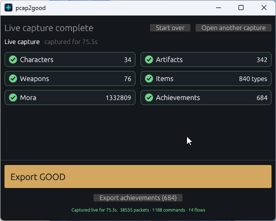

# pcap2good

[Web app](https://gwisp2.github.io/pcap2good/) ·
[Desktop downloads](https://github.com/gwisp2/pcap2good/releases/latest) ·
[Command line](#command-line-tool)

pcap2good is a complex project that aims to export Genshin Impact player data
from network packet captures into
[GOOD](https://frzyc.github.io/genshin-optimizer/#/doc) v3 data that can be
imported into Genshin Optimizer.

Everything happens locally: packet captures and decoded data are never uploaded.

## What it extracts

- Characters, including level, ascension, constellation and talent levels
- Weapons, including level, ascension and refinement
- Artifacts, including set, slot, main stat, substats and equipped character
- Materials and the player's Mora balance
- Completed achievements

## Web tool

**[Open pcap2good in your browser →](https://gwisp2.github.io/pcap2good/)**

The web tool lets you extract data from packet captures made with **Wireshark,
PCAPdroid, tcpdump** or any other capture software that writes `.pcap` or
`.pcapng` files. Drop a capture onto the page and download the GOOD document and
completed achievements as separate JSON files.

Everything runs locally in your browser; the capture is never uploaded.

## Windows desktop app

**[Download the latest Windows x64 release →](https://github.com/gwisp2/pcap2good/releases/latest)**



*Live capture result in the Windows desktop app.*

The desktop app is the easiest option on Windows. It can decode existing capture
files and capture live game traffic. Decoded data is shown as it is extracted,
and both GOOD data and achievements can be exported.

## Command-line tool

The cross-platform `pcap2good` command that does the same task the web tool does, but as a terminal command.

## Known limitations

After the login exchange the game encrypts its traffic with a session key, which
the decoder derives from the login response. Some Genshin Impact 7.1 sessions get
that response compressed with Oodle Network TCP, which the decoder does not
decompress, so sometimes you need to try to start the game again.

## Where exported data can be imported

- [Genshin Track](https://genshintrack.com/) - inventory items
- [Genshin Optimizer](https://frzyc.github.io/genshin-optimizer/) - artifacts
- [stardb.gg](https://stardb.gg/) - achievements

## Building

Rust 1.88 or newer is required.

The repository is a Cargo workspace with three packages:

- `core/` — `pcap2good-core`, the decoder library
- `cli/` — `pcap2good-cli`, the `pcap2good` command-line front end
- `gui/` — `pcap2good-gui`, the desktop app

The build needs one local dependency, which is not committed:
[Dimbreath's AnimeGameData](https://github.com/DimbreathBot/AnimeGameData) dump under `3rdparty/AnimeGameData`
(a symlink to an existing checkout works).


Build the Windows desktop app with:

```console
$ cargo build --release -p pcap2good-gui
```

## Building the web tool

The static browser front end lives in [`web/`](web). It runs the decoder in a Web
Worker via WebAssembly, so the page can be served from any static file host and
the capture never leaves the browser.

```console
# The CLI version must match the wasm-bindgen crate in Cargo.lock.
$ cargo install wasm-bindgen-cli --version 0.2.129
$ ./web/build.ps1
$ python -m http.server 8000 -d web
```

Open <http://localhost:8000>.

`web/pkg` is generated and gitignored. The page needs a real HTTP server (ES
modules and `fetch` do not work from `file://`).

## Thanks to

This project would not exist without the work of others:

- [Irminsul](https://github.com/konkers/irminsul) — the reference implementation
  this project's decoder and GOOD export logic are based on.
- [auto-artifactarium](https://github.com/konkers/auto-artifactarium) — packet
  decoding work reused for player-data extraction.
- [stardb-exporter](https://github.com/juliuskreutz/stardb-exporter) — the
  achievement exporter work that defines the stardb-compatible format.

## License

MIT. See [LICENSE](LICENSE).

